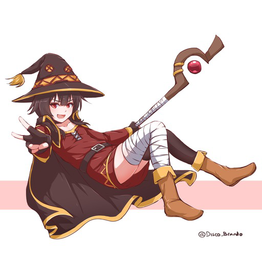

<div align="center">

# ✨ 二次元AI桌宠 v8.1.0（双语言最新版 / Dual-Language Edition）

**九大角色全动态驱动（Live2D + 3D VRM 预热秒切 + 73 帧精灵表）· 桌宠/面板展示分离 · 气泡自由拖拽/滑块定位与一键隐藏 · 摸鱼街机 10 款精选微游戏（两行网格全展示 + 内置 BGM 音乐盒）· 133 段广播级 CV 原声 · 十阶考据羁绊与长期记忆手账 · 全新视觉精修界面**

<br>

<p>
  
  
  
  
  
  
  
</p>

<p>
  <b>🌐 语言 / Language:</b>
  <b>简体中文 (当前)</b>
  ·
  <a href="https://github.com/SherlockYzz/anime-desktop-pet/blob/english/README.md"><b>English (README)</b></a>
  ·
  <a href="https://github.com/SherlockYzz/anime-desktop-pet/tree/english"><b>English Branch 🌿</b></a>
</p>

<p>
  <a href="https://github.com/SherlockYzz/anime-desktop-pet/releases/download/v8.1.0/AI-DesktopPet-v8.1.0-Setup.exe"><b>📥 点击直接下载【简体中文版】安装向导 (v8.1.0)</b></a>
  <br>
  <a href="https://github.com/SherlockYzz/anime-desktop-pet/releases/download/v8.1.0/AI-Desktop-Pet-v8.1.0-EN-Setup.exe"><b>🌍 Direct Download 【English Edition】 Setup (v8.1.0)</b></a>
  <br><br>
  <a href="https://github.com/SherlockYzz/anime-desktop-pet/releases/tag/v8.1.0">🚀 查看 v8.1.0 Release 详情</a>
  ·
  <a href="https://github.com/SherlockYzz/anime-desktop-pet">⭐ Star 支持</a>
  ·
  <a href="https://github.com/SherlockYzz/anime-desktop-pet/issues">🐛 反馈问题</a>
</p>

</div>

> 🌍 **Looking for the English Version? / 海外用户英文版已同步升级至 v8.1.0！**  
> 官方 **English Edition v8.1.0** 已与中文版完全同步：包含纯英文安装向导（NSIS 1033）、全套英文界面、9 大角色全动态模型（含高木/雪乃/零二 3D VRM）、摸鱼街机 10 款游戏与 BGM 音乐盒。  
> 📖 **英文文档 (English README)**: [English README.md](https://github.com/SherlockYzz/anime-desktop-pet/blob/english/README.md)  
> 🌿 **英文源码分支 (English Branch)**: [`english` 分支](https://github.com/SherlockYzz/anime-desktop-pet/tree/english)  
> 📥 **英文安装包直链 (Download Setup)**: [AI-Desktop-Pet-v8.1.0-EN-Setup.exe](https://github.com/SherlockYzz/anime-desktop-pet/releases/download/v8.1.0/AI-Desktop-Pet-v8.1.0-EN-Setup.exe)

---

## 🆕 v8.1.0 核心更新亮点

- **🧊 九大角色全动态模型补齐（新增 3 名 3D VRM 角色）**：高木同学、雪之下雪乃、零二全面升级为 3D VRM 动态模型（冷白柔光调色、贴身自然垂手与十指微蜷、弹簧骨稳定复位），告别静态立绘。
- **⚡ VRM 极速载入与毫秒级切换**：重构 VRM 渲染管线，持久化复用 `WebGLRenderer` 与已编译 MToon 着色器；程序启动空闲期后台静默预热 3 个 VRM 模型并去重并发解析，切换角色秒出不卡顿。
- **🖐️ 全新分部位零开销互动**：VRM 角色支持 4 部位实时骨骼反馈——**点脚轻盈跳一下**、**点手温柔挥挥手**、**摸头歪头**、**戳身点头**，不增加加载耗时且无鬼畜折臂。
- **💬 气泡系统全面进化**：支持智能贴合头顶正斜上方、鼠标按住自由拖拽、缩放弹窗内 **左右/上下滑块微调 + 大小调节 + 一键隐藏/显示气泡**（持久化保存并与快捷键 `B` 同步）。
- **📐 桌宠默认尺寸与模式展示分离**：桌宠模式默认尺寸优化为更精致的 **90%（360×540）**；**桌宠模式专属动态渲染**，**面板/网页模式统一展示高清原著封面图**，更轻更快省显存。
- **🎮 摸鱼街机体验全面升级**：
  - 控制栏保持 **6 列 × 2 行网格平铺**，全部 10 款微游戏常驻可见无遮挡；
  - 内置 BGM 音乐盒将 **《纸飞机 · 轻盈旋律》** 与 **《落花 · 治愈轻音》** 置顶前两位；
  - 进入街机默认 **角色说话静默开启** + **背景音乐自动打开**，随时可一键切换。
- **🎨 全新视觉精修与自适应布局**：标题栏与舞台主题色渐变融合、设置页 7 卡片分组导航、角色画廊两列主题配色、羁绊手账与各弹层统一视觉规范。
- **🔒 安全与稳定性加固**：全量语音防叠播（点击新语音瞬间打断旧语音）、WASD 兼容中文输入法 `e.code`、Live2D 双向垂直防裁切校准、HTML 净化与 `safeStorage` 加密存储。

---

## 🎭 一、九大角色全阵容

> **⚠️ 零 OOC（人设防崩坏）称谓铁律**：只有原创白狐仙 **「若曦」** 会称呼你为 **「主人」**；其余 8 位动漫角色全部严格遵循原作称呼（如小埋叫「哥哥」、雪乃叫「比企谷」、高木叫「西片」、零二叫「达令」），绝不串味。

<table>
<tr>
  <td align="center" width="220">
    <br>
    <b>若曦</b><br>
    <sub>原创白狐仙 · 称呼：「主人」</sub><br>
    <small>🦊 73 帧精灵表 · 16 向视线 · 12 段声线</small>
  </td>
  <td align="center" width="220">
    <br>
    <b>土间埋</b><br>
    <sub>《干物妹！小埋》 · 称呼：「哥哥」</sub><br>
    <small>🐹 Live2D 动态模型 · 35 段田中爱美原声</small>
  </td>
  <td align="center" width="220">
    <br>
    <b>雪之下雪乃</b><br>
    <sub>《春物》 · 称呼：「比企谷」</sub><br>
    <small>🧊 3D VRM 动态模型 · 10 段早见沙织原声</small>
  </td>
</tr>
<tr>
  <td align="center" width="220">
    <br>
    <b>高木同学</b><br>
    <sub>《擅长捉弄的高木同学》 · 称呼：「西片」</sub><br>
    <small>🧊 3D VRM 动态模型 · 10 段高桥李依原声</small>
  </td>
  <td align="center" width="220">
    <br>
    <b>零二 (Zero Two)</b><br>
    <sub>《DARLING in the FRANXX》 · 称呼：「达令」</sub><br>
    <small>🧊 3D VRM 动态模型 · 10 段户松遥原声</small>
  </td>
  <td align="center" width="220">
    <br>
    <b>加藤惠</b><br>
    <sub>《路人女主的养成方法》 · 称呼：「伦也君」</sub><br>
    <small>🎀 Live2D 动态模型 · 10 段安野希世乃原声</small>
  </td>
</tr>
<tr>
  <td align="center" width="220">
    <br>
    <b>惠惠</b><br>
    <sub>《为美好的世界献上祝福！》 · 称呼：「和真」</sub><br>
    <small>💥 Cubism 4 Live2D · 14 秒 Explosion 完整咏唱</small>
  </td>
  <td align="center" width="220">
    <br>
    <b>蕾姆</b><br>
    <sub>《Re:从零》 · 称呼：「昴君」</sub><br>
    <small>💙 2048 超清 Live2D · 26 段水濑祈原声</small>
  </td>
  <td align="center" width="220">
    <br>
    <b>初音未来</b><br>
    <sub>《VOCALOID》 · 称呼：「Master」</sub><br>
    <small>🎵 甩葱歌姬 Live2D · 10 段藤田咲原声</small>
  </td>
</tr>
</table>

---

## 🎮 二、摸鱼街机（10 款精选微游戏 + BGM 音乐盒）

点击标题栏游戏手柄或切换至「摸鱼街机」标签即可一键进入纯净沉浸式游戏工作台：

| 序号 | 游戏名称 | 玩法特色 |
| :---: | :--- | :--- |
| 01 | **拉海洛 · 放置** | 经典积木消除，无时间压力轻松解压 |
| 02 | **拉海洛 · 重力** | 下落旋转方块，考验手速与空间布局 |
| 03 | **六边形消除** | 蜂巢棋盘三向消行，爽快连爆 |
| 04 | **共鸣弹球** | 物理反弹打砖块，节奏明快 |
| 05 | **点点引光** | 拓扑连线回路解谜，烧脑治愈 |
| 06 | **溢彩水墨** | 步数内同化全盘色彩，策略益智 |
| 07 | **堆叠高塔** | 精准切片登顶，挑战完美连击 |
| 08 | **镜光引路** | 旋转镜面折射激光，鸣潮风格解谜 |
| 09 | **霓虹贪吃蛇** | 赛博霓虹冲刺，流畅键盘响应 |
| 10 | **律动共鸣** | 4 轨下落式音游，自带专属曲目与自动 BGM 避让 |

- **内置 14 首精选 BGM + 支持导入本机音乐**：默认置顶 **《纸飞机 · 轻盈旋律》** 与 **《落花 · 治愈轻音》**，进入街机自动开启柔和音量 BGM 并默认静默角色喝彩语音（均可在控制栏一键切换）。

---

## ⚙️ 三、核心功能一览

1. **三引擎动态桌宠 + 像素级真透明穿透**
   - 同步驱动 **Live2D (Cubism 2/4/5)**、**Three.js + `@pixiv/three-vrm` 3D VRM**、**73 帧 Sprite Atlas 精灵表**。
   - 空白透明区域 100% 物理穿透直达底层桌面窗口，仅在命中角色实体像素或交互控件时接管鼠标事件。
2. **双形态毫秒级切换（桌宠模式 / 面板工作台）**
   - **桌宠模式**（默认 `90%` / `360×540`）：悬浮常驻桌面，支持 `WASD` / 方向键自由移动（兼容中文输入法）、自动漫步、右键动作百宝箱、缩放与气泡设置弹窗。
   - **面板工作台**：展示角色高清原著封面图，提供流式 AI 聊天、多语言代码编写与运行沙箱（17 种语言）、摸鱼街机、7 卡片分组设置与自定义角色创建器。
3. **12 大云端/本地 AI 大模型 + 长期记忆羁绊手账**
   - 原生支持 DeepSeek、OpenAI、Claude、Gemini、Kimi、智谱、通义千问、硅基流动、Ollama 本地模型等，支持流式输出与代码块高亮一键复制。
   - 内置 **Lv.1 ~ Lv.10 官方考据十阶羁绊体系** 与专属角色手账，记录每日互动回忆。
4. **桌面管家三件套**
   - 专注番茄钟（25 分钟悬浮徽章）、CPU / 内存硬件状态无感提醒、实况天气播报。

---

## 🚀 四、安装与本地开发

### 方式一：直接下载安装包（推荐）
- **Windows 简体中文版**：[AI-DesktopPet-v8.1.0-Setup.exe](https://github.com/SherlockYzz/anime-desktop-pet/releases/download/v8.1.0/AI-DesktopPet-v8.1.0-Setup.exe)
- **Windows English Edition**：[AI-Desktop-Pet-v8.1.0-EN-Setup.exe](https://github.com/SherlockYzz/anime-desktop-pet/releases/download/v8.1.0/AI-Desktop-Pet-v8.1.0-EN-Setup.exe)

### 方式二：源码运行与构建
```bash
git clone https://github.com/SherlockYzz/anime-desktop-pet.git
cd anime-desktop-pet
npm install
npm start          # 启动桌宠
npm run build:win  # 打包 Windows NSIS 安装向导
```

---

## ⌨️ 五、常用快捷键

| 快捷键 | 功能 |
| :--- | :--- |
| `Ctrl + Shift + P` | 全局显示 / 隐藏桌宠窗口 |
| `Esc` / `F2` | 桌宠模式 ↔ 面板工作台快速切换 |
| `W / A / S / D` 或方向键 | 控制桌宠在桌面自由移动 |
| `T` | 开启 / 关闭桌面自动漫步 |
| `B` | 显示 / 隐藏桌宠说话气泡 |
| `F1` | 打开快捷键一览与自定义面板 |

---

## 📄 开源协议

本项目基于 [MIT License](LICENSE) 开源。各动漫角色原画、模型与配音素材仅用于个人学习与非商业二次元爱好者交流，版权归原作者及版权方所有。
