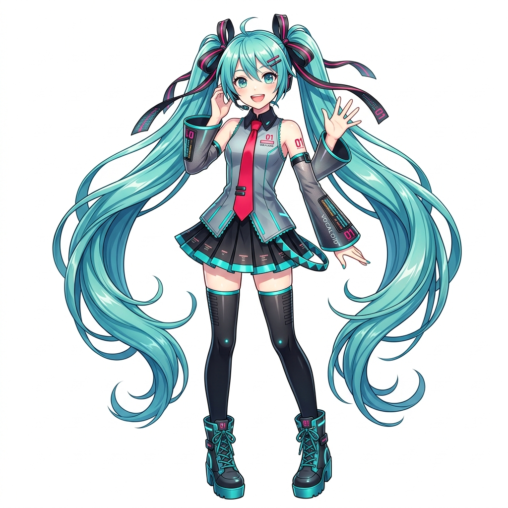
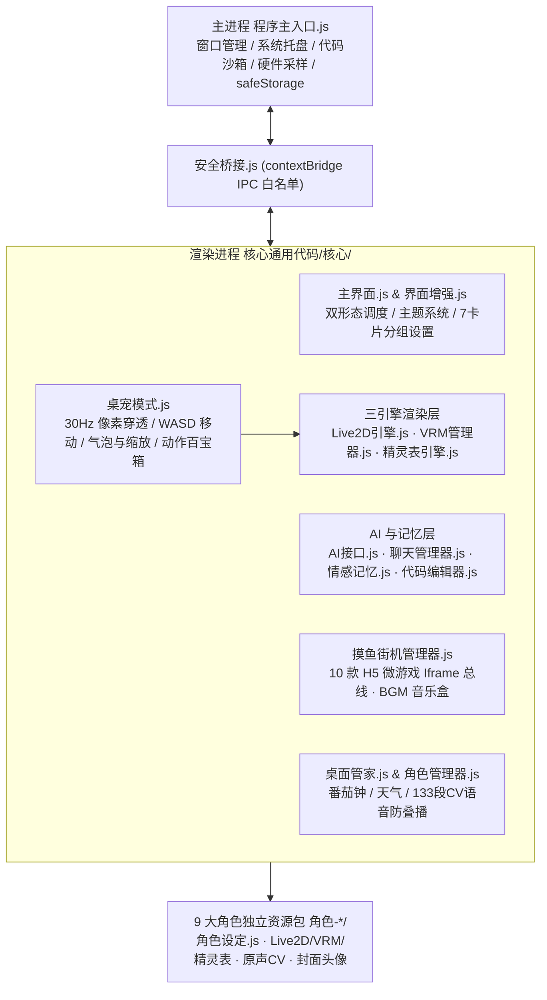

<div align="center">

# ✨ 二次元 AI 桌宠 (Anime Desktop Pet) `v8.1.0`

**高沉浸感、可对话、可玩街机、懂陪伴的跨次元桌面伴侣**

<p>
  
  
  
  
  
  
</p>

<p>
  <b>🌐 语言 / Language：</b>
  <b>简体中文（当前）</b> ·
  <a href="https://github.com/SherlockYzz/anime-desktop-pet/blob/english/README.md"><b>English README</b></a> ·
  <a href="https://github.com/SherlockYzz/anime-desktop-pet/tree/english"><b>English 分支 🌿</b></a>
</p>

</div>

---

## 📥 立即下载（v8.1.0 最新正式版）

无需配置 Node.js 或 Python 环境，下载安装向导即可开箱体验（支持自定义安装路径与自动创建桌面快捷方式）：

| 版本 | 适用系统 | 安装包直链 | 说明 |
| :--- | :--- | :--- | :--- |
| **🇨🇳 简体中文版** | Windows 10/11 (x64) | [**AI-DesktopPet-v8.1.0-Setup.exe**](https://github.com/SherlockYzz/anime-desktop-pet/releases/download/v8.1.0/AI-DesktopPet-v8.1.0-Setup.exe) | 推荐国内用户，全中文界面与中文安装向导 |
| **🌍 English Edition** | Windows 10/11 (x64) | [**AI-Desktop-Pet-v8.1.0-EN-Setup.exe**](https://github.com/SherlockYzz/anime-desktop-pet/releases/download/v8.1.0/AI-Desktop-Pet-v8.1.0-EN-Setup.exe) | Pure English NSIS 1033 setup & UI |
| **📦 Release 详情** | GitHub Releases | [**查看 v8.1.0 发布页与全部历史版本**](https://github.com/SherlockYzz/anime-desktop-pet/releases/tag/v8.1.0) | 查看各版本发布说明与 SHA-256 校验 |

---

## 🌟 项目简介

**二次元 AI 桌宠** 是一款基于 **Electron 28** 打造的开源桌面伴侣与轻量化 AI 工作台。  
它不是一个只能呆站在桌面角落的静态贴图，而是一个将 **三引擎动态角色渲染（Live2D + 3D VRM + 73 帧精灵表）**、**133 段广播级原生 CV 配音**、**12 大云端/本地大模型流式对话**、**17 种语言代码编写与运行沙箱**、**10 款精选摸鱼街机微游戏 + BGM 音乐盒**、**官方考据十阶羁绊手账** 以及 **桌面专注管家** 融为一体的完整桌面生态。

无论是敲代码、写论文、学习冲刺，还是午休摸鱼、深夜独处，9 位绝不 OOC（人设崩坏）的动漫角色都能以最自然、有温度的方式陪伴在你的桌面一隅。

---

## 🎭 九大角色全阵容

> **零 OOC 称谓铁律**：只有原创白狐仙 **「若曦」** 会称呼你为 **「主人」**；其余 8 位动漫角色全部严格遵循原作称呼（小埋叫「哥哥」、雪乃叫「比企谷」、高木叫「西片」、零二叫「达令」、加藤惠叫「伦也君」、惠惠叫「和真」、蕾姆叫「昴君」、初音叫「Master」）。

<table>
<tr>
  <td align="center" width="220">
    <br>
    <b>若曦</b><br>
    <sub>原创白狐仙 · 「主人」</sub><br>
    <small>🦊 73 帧精灵表 · 16 向视线 · 12 段声线</small>
  </td>
  <td align="center" width="220">
    <br>
    <b>土间埋</b><br>
    <sub>《干物妹！小埋》 · 「哥哥」</sub><br>
    <small>🐹 Live2D 动态模型 · 35 段田中爱美原声</small>
  </td>
  <td align="center" width="220">
    <br>
    <b>雪之下雪乃</b><br>
    <sub>《春物》 · 「比企谷」</sub><br>
    <small>🧊 3D VRM 动态模型 · 10 段早见沙织原声</small>
  </td>
</tr>
<tr>
  <td align="center" width="220">
    <br>
    <b>高木同学</b><br>
    <sub>《擅长捉弄的高木同学》 · 「西片」</sub><br>
    <small>🧊 3D VRM 动态模型 · 10 段高桥李依原声</small>
  </td>
  <td align="center" width="220">
    <br>
    <b>零二 (Zero Two)</b><br>
    <sub>《DARLING in the FRANXX》 · 「达令」</sub><br>
    <small>🧊 3D VRM 动态模型 · 10 段户松遥原声</small>
  </td>
  <td align="center" width="220">
    <br>
    <b>加藤惠</b><br>
    <sub>《路人女主的养成方法》 · 「伦也君」</sub><br>
    <small>🎀 Live2D 动态模型 · 10 段安野希世乃原声</small>
  </td>
</tr>
<tr>
  <td align="center" width="220">
    <br>
    <b>惠惠</b><br>
    <sub>《为美好的世界献上祝福！》 · 「和真」</sub><br>
    <small>💥 Cubism 4 Live2D · 14 秒 Explosion 咏唱</small>
  </td>
  <td align="center" width="220">
    <br>
    <b>蕾姆</b><br>
    <sub>《Re:从零》 · 「昴君」</sub><br>
    <small>💙 2048 超清 Live2D · 26 段水濑祈原声</small>
  </td>
  <td align="center" width="220">
    <br>
    <b>初音未来</b><br>
    <sub>《VOCALOID》 · 「Master」</sub><br>
    <small>🎵 甩葱歌姬 Live2D · 10 段藤田咲原声</small>
  </td>
</tr>
</table>

---

## ⚙️ 八大核心功能深度详解

### 1. 🧊 三引擎动态角色渲染 + 像素级真透明穿透
- **Live2D 双核驱动（Cubism 2 / 4 / 5）**：内置加藤惠、蕾姆、初音未来、惠惠、土间埋 5 名 Live2D 角色，支持 2048 超清抗锯齿、Lerp 阻尼视线与头部追踪（闲置 3.5 秒柔和回正）、自动垂直像素包围盒防裁切校准，以及主动纹理 GC 防止切角色显存泄漏。
- **3D VRM 极速管线（Three.js + `@pixiv/three-vrm`）**：高木同学、雪之下雪乃、零二均采用 3D VRM 实时渲染，针对二次元肤色定制冷白柔光、自然贴身垂手与十指微蜷姿态以及弹簧骨稳定复位。采用 **持久化复用 `WebGLRenderer`** + **空闲期后台静默预热** + **并发 Promise 去重**，彻底消除反复加载与着色器重编译卡顿。
- **73 帧 Sprite Atlas 精灵引擎**：若曦专属 2D 精灵帧动画，支持 16 向实时视线追踪、1X 标准 / 2X 超清即时切换，以及工作、睡觉、跳跃、欢呼等丰富状态机。
- **像素级真透明物理穿透**：30Hz 节流 + 尾调用补发检测当前像素透明度（Alpha > 20），空白区域完全穿透鼠标点击到底层桌面与窗口，绝不阻挡日常办公操作。

### 2. 📐 双形态无缝切换 + 桌宠/面板展示分离
- **桌宠悬浮形态（默认精致 `90%` / `360×540`）**：无边框全透明置顶悬浮，支持在 `75% ~ 135%` 区间内等比例平滑缩放（内置屏幕工作区安全上限，防止底栏出屏），左键按住拖拽移动，右键一键呼出「姿态百宝箱」。
- **面板工作台形态**：切入面板模式后统一展示角色 **高清原著静态封面图**，不再后台重复运行 WebGL/Live2D 实例，既省电省显存又让聊天、写代码和玩街机更清爽流畅。
- **全键盘自由移动**：支持 `WASD` 与方向键在桌面四向自由走动（同时匹配 `e.code` 与 `e.key`，中文输入法下同样 100% 生效），按 `T` 即可开启桌面自动漫步。

### 3. 🖐️ 分部位零开销互动 + 133 段防叠播原生 CV 声库
- **4 部位实时动作反馈**：点击桌宠不同部位会触发截然不同的专属反馈——对 VRM 角色实现 **点脚轻盈跳一下**、**点手温柔挥挥手**、**摸头歪头**、**戳身点头**，快速连点 4 下触发傲娇/暴走抗议；对 Live2D 与精灵表角色联动对应动作组与表情。
- **广播级原生语音系统**：内置 133 段经过响度均衡与尾音平滑处理的官方 CV 语音，支持 **点击新语音瞬间打断旧语音**（杜绝多段语音叠播吵闹）与 **洗牌袋不重复抽取算法**（绝不连点播同一句）。

### 4. 💬 全自由度说话气泡与姿态百宝箱
- **智能头顶锚定**：自动扫描当前角色非透明像素的头顶高度，把说话气泡稳稳摆在头顶正斜上方，既不遮挡额头也不飘太远。
- **自定义位置、大小与一键隐藏**：
  - 直接鼠标按住气泡即可拖到任意位置，并按角色独立记忆；
  - 在缩放面板的「说话气泡设置」中提供 **大小滑块（`80% ~ 140%`）**、**左右位置滑块（`15% ~ 85%`）**、**上下位置滑块（`8px ~ 420px`）** 与 **重置位置** 按钮（拖动时自动弹预览气泡实时对齐）；
  - 提供 **隐藏气泡 / 显示气泡** 一键开关，持久化保存并与快捷键 `B` 实时同步。
- **右键姿态百宝箱**：为每位角色定制专属动作清单，一键触发动作、表情、语音与字幕同步联动。

### 5. 🎮 摸鱼街机：10 款精选微游戏 + 独立 BGM 音乐盒
- **6 列 × 2 行网格常驻展示**：顶部控制栏将全部 10 款游戏一次性平铺展示，无需滚动、无遮挡，游戏区视野更宽敞：
  - **益智消除**：拉海洛·放置、拉海洛·重力、六边形消除、溢彩水墨
  - **动作反应**：共鸣弹球、堆叠高塔、霓虹贪吃蛇
  - **解谜与音游**：点点引光、镜光引路、律动共鸣（4 轨下落式音游）
- **独立 BGM 音乐盒**：内置 14 首精选纯音乐（默认置顶 **《纸飞机 · 轻盈旋律》** 与 **《落花 · 治愈轻音》**）并支持导入本机音频文件；提供单曲/列表循环与柔和音量调节。
- **贴心默认音轨策略**：进入街机默认 **开启柔和 BGM**、**默认静默角色喝彩说话**（顶部按钮随时一键开关），切入自带音轨的《律动共鸣》时自动暂停背景音乐防串音；退出街机 3 分钟后自动释放 Iframe 内存。

### 6. 🤖 12 大 AI 大模型流式对话 + 17 语言代码沙箱
- **广泛适配云端与本地模型**：开箱支持 DeepSeek、OpenAI、Claude、Gemini、Kimi、智谱 GLM、通义千问、硅基流动、Groq 及本地 **Ollama** 等 12 家服务商，兼容任意 OpenAI 格式自定义接口。
- **极速流式与免思考直觉秒回**：针对本地推理模型（如 `qwen3`）在日常闲聊场景自动注入免思考参数，大幅压低首字延迟；聊天气泡支持 Markdown 渲染、代码高亮、语言标题栏与一键复制。
- **内置代码编辑器与运行沙箱**：支持 Python、JavaScript、TypeScript、C/C++、Java、Go、Rust、Shell 等 **17 种语言**，支持让角色按描述生成代码并直接本地运行查看输出。

### 7. 📖 十阶考据羁绊手账 + 长期记忆 + 自定义角色工坊
- **Lv.1 ~ Lv.10 十阶羁绊体系**：每位角色均基于原作设定编写专属十阶羁绊称谓与手账封面（自动跟随角色主题色），日常聊天、摸头互动与陪伴计时自动积累羁绊值并记录专属回忆。
- **自定义角色创建器**：支持从零创建新角色——上传头像与封面、挑选主题色、导入 `.model3.json` Live2D 模型、编写系统提示词与原作台词集（支持 `.txt` 批量导入），并支持角色配置导出分享。

### 8. 🍅 桌面管家三件套 + 安全隐私与视觉精修
- **专注番茄钟**：一键启动 25 分钟番茄计时，桌宠模式常驻精致悬浮倒计时徽章，结束自动语音提醒休息。
- **硬件监控与实况天气**：低开销采样 CPU / 内存占用，在负载过高时由角色温柔提醒；支持实时天气问候。
- **快捷键自定义面板（`F1`）**：支持全按键录制自定义与「一键停用快捷键」防打字误触模式。
- **安全加固**：全链路 `contextIsolation` + IPC 白名单、`safeStorage` 系统级加密存储 API Key、HTML 净化防 XSS；设置页按 7 大主题卡片分组并配备顶部滚动跟随导航。

---

## 🛠️ 技术栈与代码架构

### 核心技术栈

| 分层 | 技术与组件 | 核心作用 |
| :--- | :--- | :--- |
| **桌面容器** | Electron 28 + NSIS | 无边框全透明双形态窗口、系统托盘、全局快捷键、Windows 向导打包 |
| **渲染引擎** | PIXI.js + Cubism 2/4/5 · Three.js + `@pixiv/three-vrm` · Canvas 2D | 三引擎物理画布隔离（`#pet-canvas` / `#pet-vrm-canvas` / `#pet-sprite-canvas`），纹理 GC 与 WebGLRenderer 持久化复用 |
| **安全隔离** | `contextIsolation` + `contextBridge` + `safeStorage` | 严格 IPC 白名单、API Key 加密存储、HTML 净化防 XSS、代码沙箱运行 |
| **界面样式** | 原生 CSS3 变量 + 主题色动态混色（`color-mix` / `oklch`） | 四层渐进样式：`样式.css` → `界面重构.css` → `界面精修.css` → `界面自适应.css` |
| **街机架构** | 独立 Iframe 沙箱 + `postMessage` 双向总线 | 懒加载与闲置自动卸载、父窗口按键转发、静音/BGM 联动调度 |

### 架构总览



### 目录结构速览

```text
二次元桌宠项目/
├── 程序主入口.js             # Electron 主进程：双形态窗口、托盘、安全 IPC、代码沙箱
├── 安全桥接.js               # Preload 预加载脚本：暴露受控 electronAPI
├── package.json              # 项目依赖与 electron-builder NSIS 构建配置
├── 核心通用代码/
│   ├── lib/                  # 本地离线依赖（PIXI / Cubism 2&4 / Three.js / three-vrm）
│   ├── 第三方库/             # marked.min.js / highlight.min.js
│   ├── 摸鱼街机/             # 10 款独立 H5 微游戏源码 + shared/bgm 曲库
│   └── 核心/
│       ├── index.html        # 主界面、桌宠层、缩放气泡面板、街机与设置页 DOM
│       ├── 样式.css / 界面重构.css / 界面精修.css / 界面自适应.css
│       ├── 主界面.js / 界面增强.js
│       ├── 桌宠模式.js / Live2D引擎.js / VRM管理器.js / 精灵表引擎.js
│       ├── 角色管理器.js / 角色注册表.js / 自定义角色管理器.js / 动作百宝箱.js
│       ├── AI接口.js / API服务商.js / 聊天管理器.js / 情感记忆.js / 代码编辑器.js
│       └── 摸鱼街机管理器.js / 桌面管家.js / 快捷键管理器.js / 设置管理器.js
└── 角色-*/                   # 9 位内置角色独立目录（角色设定.js / 模型 / 图片 / 音频）
```

---

## 🚀 本地开发与常用快捷键

```bash
git clone https://github.com/SherlockYzz/anime-desktop-pet.git
cd anime-desktop-pet
npm install
npm start          # 启动应用
npm run build:win  # 打包 Windows NSIS 安装向导
```

| 快捷键 | 功能 |
| :--- | :--- |
| `Ctrl + Shift + P` | 全局显示 / 隐藏桌宠窗口 |
| `Esc` / `F2` | 桌宠模式 ↔ 面板工作台快速切换 |
| `W / A / S / D` 或方向键 | 控制桌宠在桌面自由移动 |
| `T` | 开启 / 关闭桌面自动漫步 |
| `B` | 显示 / 隐藏桌宠说话气泡 |
| `F1` | 打开快捷键一览与自定义面板 |

---

## 📋 近期重要版本更新

- **v8.1.0**（`2026-11-27`）
  - 补齐高木同学、雪之下雪乃、零二 **3D VRM 动态模型**，实现九大角色全动态驱动；新增持久化 `WebGLRenderer` 复用与空闲期后台预热，大幅提速 VRM 载入与切换。
  - 新增 VRM 零开销分部位点击动作（点脚跳、点手挥手、摸头歪头、戳身点头）；气泡支持拖拽、左右/上下位置与大小滑块及一键隐藏开关。
  - 桌宠默认尺寸优化为 **90%**，实现 **桌宠模式专属动态 + 面板模式纯高清封面** 展示分离；摸鱼街机保持 10 款游戏两行网格无遮挡展示、置顶《纸飞机》《落花》并默认开启 BGM 与静默角色说话；同步发布最新版 **English Edition v8.1.0**。
- **v8.0.1**（`2026-11-26`）
  - 全面安全加固（HTML 净化、`safeStorage` 密钥加密、IPC 白名单、Worker 沙箱）与功耗启动优化（街机懒加载、隐藏停帧、30Hz 穿透节流），上线全新视觉精修界面与 7 卡片分组设置页。
- **v08.00**（`2026-10-16`）
  - 摸鱼街机扩容至全套 10 款轻量 H5 微游戏，新增 4 轨音游《律动共鸣》与纯净沉浸街机视窗，实装全场景像素级物理穿透。
- **v07.22**（`2026-10-16`）
  - 首发「摸鱼街机」微游戏套件与 133 段原生 CV 实时喝彩联动，打通游戏互动与十阶好感度羁绊闭环。

---

## 💬 欢迎下载体验与一起共建！

如果你喜欢二次元、写代码时需要一点轻松陪伴，或者对桌面 AI 伴侣有各种奇思妙想，**非常欢迎直接下载安装包试试看**！

- 🌟 觉得好用或有意思，点一颗 **Star** 就是给项目最大的鼓励；
- 💡 想要新增哪位角色、哪类小游戏，或者有任何新奇的互动点子，欢迎随时来 [Issues](https://github.com/SherlockYzz/anime-desktop-pet/issues) 或 [Discussions](https://github.com/SherlockYzz/anime-desktop-pet/discussions) 提建议、出主意；
- 🐛 使用中遇到任何 Bug 或不够顺手的细节，也欢迎直接反馈，我们会持续打磨迭代；
- 🤝 同样欢迎提交 Pull Request，一起把桌面一角变得更有温度！

---

## 📄 开源协议

本项目基于 [MIT License](LICENSE) 开源。项目内涉及的动漫角色原画、模型与配音素材均归原作者及版权方所有，仅用于个人学习与非商业二次元爱好者交流。
