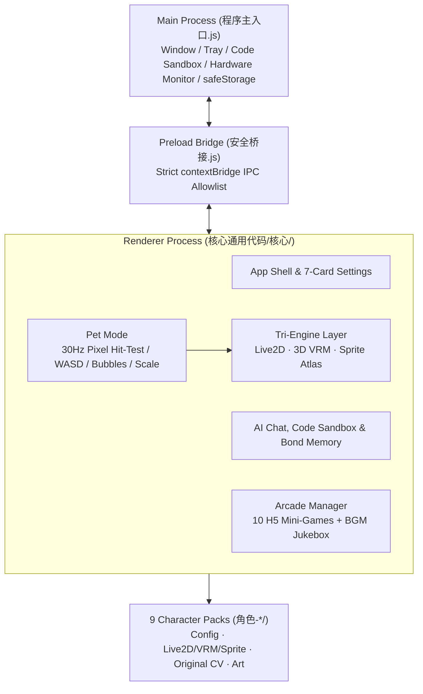

<div align="center">

# ✨ AI Desktop Pet `v8.1.0` (English Edition)

**An Immersive, Interactive, LLM-Powered Anime Companion & Mini-Games Workbench for Your Desktop**

<p>
  
  
  
  
  
  
</p>

<p>
  <b>🌐 Language / 语言:</b>
  <b>English (Current)</b> ·
  <a href="https://github.com/SherlockYzz/anime-desktop-pet/blob/main/README.md"><b>简体中文 README</b></a> ·
  <a href="https://github.com/SherlockYzz/anime-desktop-pet/tree/main"><b>Chinese Branch 🌿</b></a>
</p>

</div>

---

## 📥 Direct Downloads (Latest `v8.1.0`)

No Node.js or Python setup required—download the installer wizard and start right away:

| Edition | Platform | Direct Installer Link | Notes |
| :--- | :--- | :--- | :--- |
| **🌍 English Edition** | Windows 10/11 (x64) | [**AI-Desktop-Pet-v8.1.0-EN-Setup.exe**](https://github.com/SherlockYzz/anime-desktop-pet/releases/download/v8.1.0/AI-Desktop-Pet-v8.1.0-EN-Setup.exe) | Pure English NSIS 1033 wizard & UI |
| **🇨🇳 Simplified Chinese** | Windows 10/11 (x64) | [**AI-DesktopPet-v8.1.0-Setup.exe**](https://github.com/SherlockYzz/anime-desktop-pet/releases/download/v8.1.0/AI-DesktopPet-v8.1.0-Setup.exe) | Full Simplified Chinese edition |
| **📦 Release Page** | GitHub Releases | [**View v8.1.0 Release Notes & History**](https://github.com/SherlockYzz/anime-desktop-pet/releases/tag/v8.1.0) | Changelogs & SHA-256 checksums |

---

## 🌟 About the Project

**AI Desktop Pet** is an open-source desktop companion and lightweight AI workbench built with **Electron 28**.  
Far more than a static desktop sticker, it brings together **tri-engine animated rendering (Live2D Cubism 2/4/5 + 3D VRM + 73-frame Sprite Atlas)**, **133 broadcast-grade original CV voice clips**, **streaming chat across 12 cloud & local LLMs**, a **17-language code editor & sandbox**, a **10-game built-in Arcade with BGM Jukebox**, a **10-tier Bond & Memory Diary**, and a **Desktop Focus Butler**.

---

## 🎭 9 Iconic Anime Companions

<table>
<tr>
  <td align="center" width="220">
    <br>
    <b>Ruoxi</b><br>
    <sub>Original White Fox Spirit</sub><br>
    <small>🦊 73-Frame Sprite Atlas · 16-Dir Gaze · 12 Voices</small>
  </td>
  <td align="center" width="220">
    <br>
    <b>Umaru Doma</b><br>
    <sub>Himouto! Umaru-chan</sub><br>
    <small>🐹 Live2D Model · 35 Original CV Lines</small>
  </td>
  <td align="center" width="220">
    <br>
    <b>Yukino Yukinoshita</b><br>
    <sub>Oregairu</sub><br>
    <small>🧊 3D VRM Model · 10 Saori Hayami Lines</small>
  </td>
</tr>
<tr>
  <td align="center" width="220">
    <br>
    <b>Takagi-san</b><br>
    <sub>Teasing Master Takagi-san</sub><br>
    <small>🧊 3D VRM Model · 10 Rie Takahashi Lines</small>
  </td>
  <td align="center" width="220">
    <br>
    <b>Zero Two</b><br>
    <sub>DARLING in the FRANXX</sub><br>
    <small>🧊 3D VRM Model · 10 Haruka Tomatsu Lines</small>
  </td>
  <td align="center" width="220">
    <br>
    <b>Megumi Kato</b><br>
    <sub>Saekano</sub><br>
    <small>🎀 Live2D Model · 10 Kiyono Yasuno Lines</small>
  </td>
</tr>
<tr>
  <td align="center" width="220">
    <br>
    <b>Megumin</b><br>
    <sub>KonoSuba</sub><br>
    <small>💥 Cubism 4 Live2D · Full 14s Explosion Chant</small>
  </td>
  <td align="center" width="220">
    <br>
    <b>Rem</b><br>
    <sub>Re:ZERO</sub><br>
    <small>💙 2048 HD Live2D · 26 Inori Minase Lines</small>
  </td>
  <td align="center" width="220">
    <br>
    <b>Hatsune Miku</b><br>
    <sub>VOCALOID</sub><br>
    <small>🎵 Live2D Model · 10 Saki Fujita Lines</small>
  </td>
</tr>
</table>

---

## ⚙️ Deep Dive Into Core Features

### 1. 🧊 Tri-Engine Live Rendering & Pixel-Accurate Click-Through
- **Live2D Cubism 2/4/5**: Powers Megumi Kato, Rem, Hatsune Miku, Megumin, and Umaru with 2048 anti-aliased rendering, smooth Lerp eye/head tracking, automatic vertical bounding-box alignment, and active texture GC.
- **3D VRM Fast Pipeline (Three.js + `@pixiv/three-vrm`)**: Powers Takagi-san, Yukino Yukinoshita, and Zero Two with cool-white balanced lighting, natural resting arms & curled fingers, persistent `WebGLRenderer` reuse, and idle background prewarming for instant character switching.
- **73-Frame Sprite Atlas**: Dedicated 2D sprite engine for Ruoxi with 16-direction gaze tracking, 1X/2X HD switching, and rich state animations (work, sleep, jump, wave, wander).
- **True Transparent Click-Through**: 30Hz pixel Alpha hit-testing lets clicks pass straight through transparent areas to underlying desktop windows.

### 2. 📐 Dedicated Pet vs. Panel Separation & 90% Default Scale
- **Pet Mode (default `90%` / `360×540`)**: Frameless, always-on-top live companion with smooth `75%–135%` scaling, drag-to-move, IME-safe `WASD`/Arrow walking, and Auto-Wander (`T`).
- **Panel Workbench Mode**: Displays crisp original high-res artwork with zero redundant WebGL overhead for fast, lightweight chatting, coding, and arcade sessions.

### 3. 🖐️ Zero-Overhead Body-Part Interactions & 133 Non-Overlapping CV Voices
- Tap different body zones on VRM characters for natural real-time bone feedback: **tap feet to hop**, **tap hands to wave**, **pat head to tilt**, **poke body to nod**, or rapid-tap 4 times for special reactions.
- 133 original CV voice lines with shuffle-bag deduplication and instant interruption (tapping a new line immediately stops the previous clip—zero overlapping audio).

### 4. 💬 Fully Customizable Speech Bubbles & Action Toolbox
- Smart head-top anchor detection positions bubbles neatly above each character without covering their forehead.
- Drag bubbles freely by mouse, or fine-tune **Size (`80%–140%`)**, **Horizontal (`15%–85%`)**, **Vertical (`8px–420px`)**, **Reset Position**, and **Hide/Show Bubble** (persisted and synced with `B`) inside the scale menu.

### 5. 🎮 10-Game Built-in Arcade + Independent BGM Jukebox
- All **10 standalone H5 mini-games** stay visible at once in a clean **6×2 grid**: Lahairo Blocks (Place), Lahairo Blocks (Gravity), Hexa Clear, Resonance Pinball, Light Circuit, Ink Flood, Stack Tower, Mirror Laser, Neon Snake, and Rhythm Resonance (4-lane rhythm game).
- Built-in **BGM Jukebox** with 14 curated tracks (pinning **Paper Plane** and **Falling Blossoms** at the top) plus local audio import. Entering Arcade defaults to **BGM ON** and **Pet Voice Muted**, with automatic ducking when playing the rhythm game.

### 6. 🤖 12 LLM Providers, 17-Language Code Sandbox, Bond Diary & Focus Butler
- Supports OpenAI, Claude, Gemini, DeepSeek, Kimi, Zhipu, Qwen, SiliconFlow, Groq, and local **Ollama** with streaming Markdown and one-click code copy.
- Built-in code editor & local sandbox supporting **17 languages** + AI code generation.
- **Lv.1–Lv.10 Bond & Memory Diary** per character, **Custom Character Creator**, **25-minute Pomodoro timer**, **CPU/RAM monitor**, **live weather**, **custom shortcut manager (`F1`)**, and `safeStorage` API key encryption.

---

## 🛠️ Tech Stack & Architecture

- **Desktop Shell**: Electron 28 + NSIS 1033 (frameless transparent dual-mode window, system tray, global shortcuts)
- **Rendering Layer**: PIXI.js + Live2D Cubism 2/4/5 · Three.js + `@pixiv/three-vrm` · Canvas 2D Sprite Atlas
- **Security Layer**: `contextIsolation`, `contextBridge` IPC allowlist, OS-level `safeStorage` encryption, HTML sanitization, sandboxed execution
- **UI & Arcade**: 4-layer CSS system (base → layout → polish → responsive) with dynamic character themes; sandboxed Iframe games on a `postMessage` bus



---

## 🚀 Run from Source & Shortcuts

```bash
git clone -b english https://github.com/SherlockYzz/anime-desktop-pet.git
cd anime-desktop-pet
npm install
npm start          # Launch app
npm run build:win  # Build Windows NSIS installer
```

- `Ctrl + Shift + P` — Toggle window visibility globally
- `Esc` / `F2` — Switch between Pet Mode & Panel Workbench
- `W / A / S / D` or Arrow Keys — Move across the desktop
- `T` — Auto-Wander · `B` — Toggle Speech Bubbles · `F1` — Shortcut Manager

---

## 📋 Recent Major Updates

- **v8.1.0** (`2026-11-27`)
  - Added full **3D VRM models** for Takagi-san, Yukino Yukinoshita, and Zero Two with persistent `WebGLRenderer` reuse and idle background prewarming.
  - Added zero-overhead body-part animations (foot hop, hand wave, head tilt, body nod), bubble X/Y sliders & Hide toggle, **90% default pet size**, and dedicated Pet vs. Panel separation.
  - Restored 6×2 full-visibility grid for all 10 Arcade games, pinned Paper Plane & Falling Blossoms BGM, defaulted Arcade to BGM ON + Pet Voice Muted, and synced the full **English Edition v8.1.0**.
- **v8.0.1** (`2026-11-26`)
  - Security hardening (HTML sanitization, `safeStorage` encryption, IPC allowlist, Worker sandbox), startup & idle power optimization, and redesigned 7-card Settings & polished UI.
- **v08.00** (`2026-10-16`)
  - Expanded Arcade to 10 standalone H5 mini-games (adding 4-lane rhythm game *Rhythm Resonance*) and pixel-accurate click-through.
- **v07.22** (`2026-10-16`)
  - Introduced the built-in Mini-Games Arcade with 133 original CV voice reactions integrated into the 10-tier bond system.

---

## 💬 Join Us & Share Your Ideas!

We warmly invite you to **download, try it out, and help shape what comes next**!

- 🌟 If you enjoy the project, dropping a **Star** on GitHub means the world to us;
- 💡 Have ideas for new characters, mini-games, animations, or quality-of-life improvements? Share them anytime in [Issues](https://github.com/SherlockYzz/anime-desktop-pet/issues) or [Discussions](https://github.com/SherlockYzz/anime-desktop-pet/discussions);
- 🐛 Spotted a bug or rough edge? Let us know and we'll keep polishing;
- 🤝 Pull Requests are always welcome!

---

## 📄 License

Released under the [MIT License](LICENSE). All character artwork, 3D/Live2D models, and voice clips belong to their respective original creators and copyright holders and are provided strictly for personal, non-commercial enjoyment.
