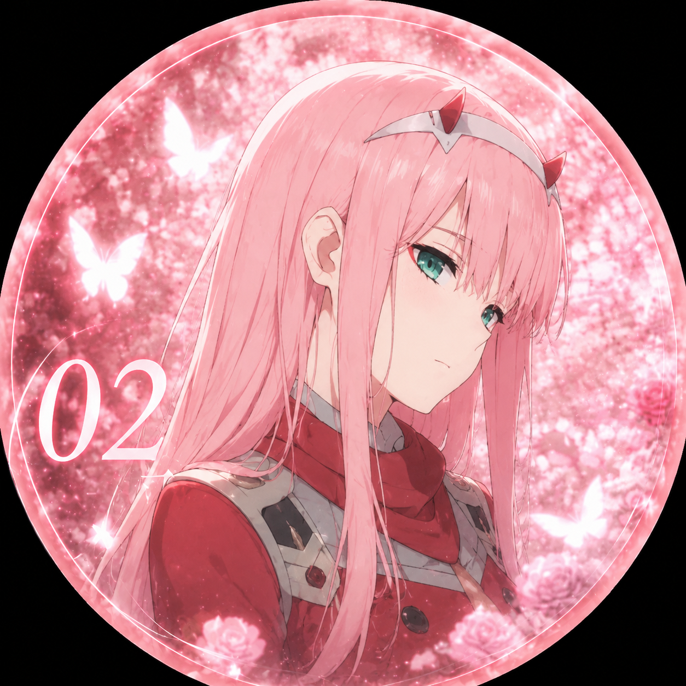

<div align="center">

# ✨ 二次元 AI 桌宠 (Anime Desktop Pet) `v8.1.0`

**高沉浸感、可对话、可玩街机、懂陪伴的跨次元桌面伴侣**

<p>
  
  
  
  
  
  
</p>

<p>
  <b>🌐 语言 / Language：</b>
  <b>简体中文（当前）</b> ·
  <a href="https://github.com/SherlockYzz/anime-desktop-pet/blob/english/README.md"><b>English README</b></a> ·
  <a href="https://github.com/SherlockYzz/anime-desktop-pet/tree/english"><b>English 分支 🌿</b></a>
</p>

</div>

---

## 📥 立即下载（v8.1.0 最新正式版）

无需配置环境，下载安装向导即可开箱体验（支持自定义安装路径与自动创建桌面快捷方式）：

| 版本 | 适用系统 | 安装包直链 | 说明 |
| :--- | :--- | :--- | :--- |
| **🇨🇳 简体中文版** | Windows 10/11 (x64) | [**AI-DesktopPet-v8.1.0-Setup.exe**](https://github.com/SherlockYzz/anime-desktop-pet/releases/download/v8.1.0/AI-DesktopPet-v8.1.0-Setup.exe) | 推荐国内用户，全中文界面与中文安装向导 |
| **🌍 English Edition** | Windows 10/11 (x64) | [**AI-Desktop-Pet-v8.1.0-EN-Setup.exe**](https://github.com/SherlockYzz/anime-desktop-pet/releases/download/v8.1.0/AI-Desktop-Pet-v8.1.0-EN-Setup.exe) | Pure English NSIS 1033 setup & UI |
| **📦 全部历史发布** | GitHub Releases | [**查看所有 Releases 与校验信息**](https://github.com/SherlockYzz/anime-desktop-pet/releases/tag/v8.1.0) | 查看各版本发布说明与安装包 |

---

## 🌟 项目简介

**二次元 AI 桌宠** 是一款基于 **Electron 28** 打造的开源桌面伴侣与轻量化 AI 工作台。  
它不是一个只能呆站在桌面角落的静态贴图，而是一个集 **多引擎动态角色渲染（Live2D + 3D VRM + 73 帧精灵表）**、**133 段原生 CV 配音**、**12 大云端/本地大模型流式对话**、**17 种语言代码编写与运行沙箱**、**10 款精选摸鱼街机微游戏 + BGM 音乐盒**、**十阶考据羁绊手账** 以及 **桌面专注管家** 于一体的完整桌面生态。

无论是敲代码、写论文、看番摸鱼，还是深夜赶工，9 位绝不 OOC（人设崩坏）的动漫角色都能以最自然的方式陪伴在你的桌面一隅。

---

## 🎭 九大角色全阵容

> **零 OOC 称谓铁律**：只有原创白狐仙 **「若曦」** 会称呼你为 **「主人」**；其余 8 位动漫角色全部严格遵循原作称呼（小埋叫「哥哥」、雪乃叫「比企谷」、高木叫「西片」、零二叫「达令」、加藤惠叫「伦也君」、惠惠叫「和真」、蕾姆叫「昴君」、初音叫「Master」）。

<table>
<tr>
  <td align="center" width="220">
    <br>
    <b>若曦</b><br>
    <sub>原创白狐仙 · 「主人」</sub><br>
    <small>🦊 73 帧精灵表 · 16 向视线 · 12 段声线</small>
  </td>
  <td align="center" width="220">
    <br>
    <b>土间埋</b><br>
    <sub>《干物妹！小埋》 · 「哥哥」</sub><br>
    <small>🐹 Live2D 动态模型 · 35 段田中爱美原声</small>
  </td>
  <td align="center" width="220">
    <br>
    <b>雪之下雪乃</b><br>
    <sub>《春物》 · 「比企谷」</sub><br>
    <small>🧊 3D VRM 动态模型 · 10 段早见沙织原声</small>
  </td>
</tr>
<tr>
  <td align="center" width="220">
    <br>
    <b>高木同学</b><br>
    <sub>《擅长捉弄的高木同学》 · 「西片」</sub><br>
    <small>🧊 3D VRM 动态模型 · 10 段高桥李依原声</small>
  </td>
  <td align="center" width="220">
    <br>
    <b>零二 (Zero Two)</b><br>
    <sub>《DARLING in the FRANXX》 · 「达令」</sub><br>
    <small>🧊 3D VRM 动态模型 · 10 段户松遥原声</small>
  </td>
  <td align="center" width="220">
    <br>
    <b>加藤惠</b><br>
    <sub>《路人女主的养成方法》 · 「伦也君」</sub><br>
    <small>🎀 Live2D 动态模型 · 10 段安野希世乃原声</small>
  </td>
</tr>
<tr>
  <td align="center" width="220">
    <br>
    <b>惠惠</b><br>
    <sub>《为美好的世界献上祝福！》 · 「和真」</sub><br>
    <small>💥 Cubism 4 Live2D · 14 秒 Explosion 咏唱</small>
  </td>
  <td align="center" width="220">
    <br>
    <b>蕾姆</b><br>
    <sub>《Re:从零》 · 「昴君」</sub><br>
    <small>💙 2048 超清 Live2D · 26 段水濑祈原声</small>
  </td>
  <td align="center" width="220">
    <br>
    <b>初音未来</b><br>
    <sub>《VOCALOID》 · 「Master」</sub><br>
    <small>🎵 甩葱歌姬 Live2D · 10 段藤田咲原声</small>
  </td>
</tr>
</table>

> 此外还内置 **自定义角色创建器**，支持导入你喜欢的立绘、Live2D 模型、提示词与原作台词集，打造属于你的第 10 位专属桌宠。

---

## ⚙️ 核心功能详解

### 1. 三引擎动态桌宠 + 像素级物理穿透
- **全阵容动态驱动**：同时集成 **Live2D (Cubism 2/4/5)**、**Three.js + `@pixiv/three-vrm` 3D VRM** 以及 **73 帧 Sprite Atlas 2D 精灵表**，全部 9 位角色均在桌宠模式拥有流畅的呼吸、眨眼、视线追踪与互动动作。
- **VRM 毫秒级热切**：持久化复用 `WebGLRenderer` 与已编译 MToon 着色器，并在程序启动空闲期后台静默预热三名 VRM 角色（高木同学、雪之下雪乃、零二），告别反复加载卡顿。
- **像素级真透明穿透**：透明背景区域直接穿透点击底层桌面窗口与图标，仅在光标落到角色实体像素（Alpha > 20）或交互浮层时接管鼠标事件。
- **分部位零开销互动**：点脚跳一下、点手温柔挥挥手、摸头歪头、戳身点头、四连击触发傲娇/抗议反馈，搭配 **133 段防叠播原生 CV 语音** 与洗牌袋随机不重复机制。

### 2. 桌宠/面板展示分离 + 自由气泡控制
- **清晰的双形态分工**：
  - **桌宠模式**（默认精致 **90% / 360×540**，支持 `75% ~ 135%` 屏幕安全缩放）：专属运行动态模型，支持 `WASD` / 方向键自由行走（兼容中文输入法）、自动漫步、右键动作百宝箱。
  - **面板工作台**：统一展示角色高清原著封面图，不重复占用 WebGL 显存，界面切换丝滑瞬开。
- **气泡随心掌控**：按角色头顶智能锚定斜上方，支持按住气泡自由拖拽、在缩放面板通过 **左右/上下滑块 + 大小滑块** 实时微调，支持 **一键隐藏/显示气泡**（持久化保存并与 `B` 键同步）。

### 3. 摸鱼街机（10 款精选微游戏 + BGM 音乐盒）
- **两行 6 列网格常驻展示全部 10 款游戏**（无遮挡、免滚动）：拉海洛·放置、拉海洛·重力、六边形消除、共鸣弹球、点点引光、溢彩水墨、堆叠高塔、镜光引路、霓虹贪吃蛇、律动共鸣（4 轨音游）。
- **独立 BGM 音乐盒**：内置 14 首精选曲目（默认置顶 **《纸飞机 · 轻盈旋律》** 与 **《落花 · 治愈轻音》**）并支持导入本机音乐；进入街机默认 **开启柔和 BGM** 且 **默认静默角色喝彩语音**，切入音游自动避让防串音。

### 4. AI 对话、代码沙箱、羁绊手账与桌面管家
- **12 大主流 AI 服务商**：原生适配 DeepSeek、OpenAI、Claude、Gemini、Kimi、智谱、通义千问、硅基流动及本地 Ollama（支持跳过思考链实现亚秒级直觉回复），全流式渲染 + 代码块语言标题与一键复制。
- **17 种语言代码编辑器与运行沙箱**：支持让角色帮你写代码、直接运行查看输出。
- **官方考据十阶羁绊 & 长期记忆手账**：每日互动积累好感，从 `Lv.1` 演进至 `Lv.10`，专属手账记录你们的点滴。
- **桌面管家三件套**：25 分钟悬浮番茄钟、CPU/内存负载无感提醒、实况天气播报。

---

## 🛠️ 技术栈与代码架构

### 核心技术栈

| 分层 | 技术与组件 | 说明 |
| :--- | :--- | :--- |
| **桌面容器** | Electron 28 + NSIS | 无边框全透明双形态窗口、系统托盘、全局快捷键、Windows 向导打包 |
| **渲染引擎** | PIXI.js + Cubism 2/4/5 · Three.js + `@pixiv/three-vrm` · Canvas 2D | 三引擎物理画布隔离（`#pet-canvas` / `#pet-vrm-canvas` / `#pet-sprite-canvas`），主动显存 GC 与渲染器持久化复用 |
| **安全隔离** | `contextIsolation` + `contextBridge` + `safeStorage` | 严格 IPC 白名单、API 密钥系统级加密存储、HTML/Markdown 净化防 XSS、代码沙箱运行 |
| **界面样式** | 原生 CSS3 变量 + 主题色动态混色 (`color-mix` / `oklch`) | 四层渐进样式：`样式.css` → `界面重构.css` → `界面精修.css` → `界面自适应.css` |
| **街机架构** | 独立 Iframe 沙箱 + `postMessage` 双向事件总线 | 懒加载与闲置自动卸载、父窗口按键转发、音频状态同步与独立 BGM 调度 |

### 架构总览


### 目录结构速览

```text
二次元桌宠项目/
├── 程序主入口.js             # Electron 主进程：双形态窗口、托盘、安全 IPC、代码沙箱
├── 安全桥接.js               # Preload 预加载脚本：暴露受控 electronAPI
├── package.json              # 项目依赖与 electron-builder NSIS 构建配置
├── 核心通用代码/
│   ├── lib/                  # 本地化离线依赖（PIXI / Cubism / Three.js / three-vrm）
│   ├── 第三方库/             # marked.min.js / highlight.min.js
│   ├── 摸鱼街机/             # 10 款独立 H5 微游戏源码 + shared/bgm 曲库
│   └── 核心/
│       ├── index.html        # 主界面、桌宠层、缩放气泡面板、街机与设置页 DOM
│       ├── 样式.css / 界面重构.css / 界面精修.css / 界面自适应.css
│       ├── 主界面.js / 界面增强.js
│       ├── 桌宠模式.js / Live2D引擎.js / VRM管理器.js / 精灵表引擎.js
│       ├── 角色管理器.js / 角色注册表.js / 自定义角色管理器.js / 动作百宝箱.js
│       ├── AI接口.js / API服务商.js / 聊天管理器.js / 情感记忆.js / 代码编辑器.js
│       └── 摸鱼街机管理器.js / 桌面管家.js / 快捷键管理器.js / 设置管理器.js
└── 角色-*/                   # 9 位内置角色独立目录（角色设定.js / 模型 / 图片 / 音频）
```

---

## 🚀 本地运行与快捷键

### 源码运行与打包
```bash
git clone https://github.com/SherlockYzz/anime-desktop-pet.git
cd anime-desktop-pet
npm install
npm start          # 启动应用
npm run build:win  # 打包 Windows 安装向导
```

### 常用快捷键
- `Ctrl + Shift + P`：全局显示 / 隐藏桌宠
- `Esc` / `F2`：桌宠模式 ↔ 面板工作台快速切换
- `W / A / S / D` 或方向键：控制桌宠在桌面自由移动
- `T`：开启 / 关闭桌面自动漫步
- `B`：显示 / 隐藏桌宠说话气泡
- `F1`：查看与自定义全部快捷键

---

## 📋 近期重要版本更新

- **v8.1.0**（`2026-11-27`）
  - 补齐高木同学、雪之下雪乃、零二 **3D VRM 动态模型**，实现九大角色全动态驱动；新增持久化 `WebGLRenderer` 复用与空闲期后台预热，大幅提速 VRM 载入与切换。
  - 新增 VRM 零开销分部位点击动作（点脚跳、点手挥手、摸头歪头、戳身点头）；气泡支持拖拽、左右/上下位置与大小滑块及一键隐藏开关。
  - 桌宠默认尺寸优化为 **90%**，实现 **桌宠模式专属动态 + 面板模式纯高清封面** 展示分离；摸鱼街机恢复 10 款游戏两行网格无遮挡展示、置顶《纸飞机》《落花》并默认开启 BGM 与静默角色说话；同步发布最新版 **English Edition v8.1.0**。
- **v8.0.1**（`2026-11-26`）
  - 全面安全加固（HTML 净化、`safeStorage` 密钥加密、IPC 白名单、Worker 沙箱）与功耗启动优化（街机懒加载、隐藏停帧、30Hz 穿透节流），上线全新视觉精修界面与 7 卡片分组设置页。
- **v08.00**（`2026-10-16`）
  - 摸鱼街机扩容至全套 10 款轻量 H5 微游戏，新增 4 轨音游《律动共鸣》与纯净沉浸街机视窗，实装全场景像素级物理穿透。
- **v07.22**（`2026-10-16`）
  - 首发「摸鱼街机」微游戏套件与 133 段原生 CV 实时喝彩联动，打通游戏互动与十阶好感度羁绊闭环。

---

## 💬 欢迎体验与共建

如果你喜欢二次元、写代码时需要一点轻松陪伴，或者对桌面 AI 伴侣有天马行空的想法，**非常欢迎直接下载安装包试试看**！

- 🌟 觉得好用或有意思，顺手点一颗 **Star** 就是对项目最大的鼓励；
- 💡 有任何脑洞、想要的新角色、新小游戏或交互点子，欢迎随时来 [Issues](https://github.com/SherlockYzz/anime-desktop-pet/issues) 或 [Discussions](https://github.com/SherlockYzz/anime-desktop-pet/discussions) 提建议、出主意；
- 🐛 遇到任何 Bug 或体验不顺手的地方，也欢迎直接反馈，我们会持续迭代打磨；
- 🤝 同样欢迎提交 Pull Request 一起把桌面角落变得更有趣！

---

## 📄 开源协议

本项目基于 [MIT License](LICENSE) 开源。项目内涉及的动漫角色原画、模型与配音素材均归原作者及版权方所有，仅用于个人学习与非商业二次元爱好者交流。
